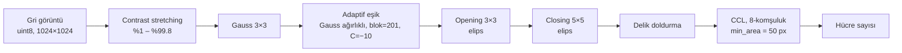

# Klasik Görüntü İşleme ile Mikroskobik Görüntülerde Hücre Sayımı

**YZM507 Sayısal Görüntü İşleme — Ara Sınav Projesi** · Halil Çankaroğlu

Cell Tracking Challenge **Fluo-N2DH-GOWT1** veri setinde, yalnızca klasik görüntü işleme yöntemleriyle
(derin öğrenme yok) hücre segmentasyonu ve sayımı yapan, yöntem seçimini kontrollü deneylerle ve
doğrulama verisiyle gerekçelendiren, test performansını kilitlenmiş tahminlerle ölçen tekrarlanabilir bir çalışma.

[](https://colab.research.google.com/github/halilcankaroglu/yzm507-cell-counting/blob/main/main.ipynb)

## Veri seti
- Kaynak: https://celltrackingchallenge.net/2d-datasets/
- Eğitim arşivi: https://data.celltrackingchallenge.net/training-datasets/Fluo-N2DH-GOWT1.zip
- Notebook arşivi otomatik indirir. Colab'da `/content/data`, yerelde `./data` kullanılır;
  farklı bir konum için `CTC_DATA_DIR` ortam değişkeni ayarlanabilir.
- **Veri setine ait görüntüler ve maskeler bu repoda yoktur.** Notebook çıktıları commit sırasında
  `nbstripout` ile temizlenir; görseller yalnızca yerel `figures/` klasörüne yazılır (`.gitignore`).

## Deneysel tasarım
| Grup | Kare sayısı | Kaynak | Kullanım |
|---|---|---|---|
| Geliştirme | 10 | Sekans 01 | Kontrollü deneyler (E01–E36) |
| Doğrulama | 5 | Sekans 01 | Aday pipeline seçimi |
| Test | 15 (3 blok × 5 ardışık) | Sekans 02 | Kilitli bağımsız değerlendirme |

- **Seed:** öğrenci numarasının son 5 hanesi + 2026 = **31042** (`numpy.random.default_rng`)
- Geliştirme ve doğrulama kareleri arasında ve test blokları arasında en az 5 karelik boşluk.
- **Referans sayı:** `XX_GT/TRA/man_trackNNN.tif` içindeki farklı pozitif etiketlerin sayısı.

## Nihai pipeline (Pipeline D)

**Baseline:** gri görüntü → Otsu eşikleme → bağlı bileşen analizi (8-komşuluk) → min_area = 50 px.
Parametrelerin tamamı `final_pipeline.json` dosyasındadır.

## Sonuçlar
**Doğrulama (5 kare):**

| Pipeline | Açıklama | MAE | RMSE | Seçim |
|---|---|---|---|---|
| D | Adaptif eşik + open/close | 1.0 | 1.342 | ✅ |
| B | Sabit eşik + close + watershed | 1.0 | 1.844 | |
| A | Sabit eşik (T=20) + close | 1.4 | 1.612 | |
| C | Triangle eşik + close | 3.8 | 4.539 | |

Seçim kuralı: en düşük MAE; eşitlikte RMSE, süre, karmaşıklık.

**Test (15 kare, kilitli tahminler):**

| Yöntem | MAE | RMSE | Bias | Tam doğru oran | Süre (s/kare) |
|---|---|---|---|---|---|
| Baseline | 8.667 | 9.812 | +1.067 | 0.000 | 0.028 |
| Nihai (D) | **2.133** | **2.556** | +2.133 | 0.067 | 0.189 |

## Test sızıntısını önleme ve kilit kanıtı
- Değerlendirme fonksiyonu test grubuyla çağrıldığında `assert` ile durur; test referansları
  kilitten önce okunmaz.
- **Kilit commit'i:** `0a21ffb`, tag **`test-lock`** — `final_pipeline.json` ve `test_predictions_locked.csv`.
- Kilitlenen kodu içeren notebook teknik bir aktarım nedeniyle bir sonraki commit'te (`336d568`)
  eklenmiştir; test referansları her iki commit'ten sonra okunmuştur.
- Tahmin sütunlarının SHA-256 özeti: `39f1ccf56ea19fafc6c78c3a96a3c6fd896b7b8ab4417dd16c12a9881b93ea5f`.
  Test değerlendirme hücresi bu özeti doğrulamadan referansları okumaz. Özet iki bağımsız
  çalıştırmada aynı çıkmıştır.
- Kilitten sonra görünen tekrar commit'leri (ör. `f88ab6e` C4 … `13d9152` C7), notebook'un baştan
  yeniden çalıştırılmasıyla oluşmuştur. Yalnızca süre sütunları değişmiştir; kare seçimi ve referans
  sayıları değişmediği için C2 ve C3 hiç tekrar commit'lenmemiştir. Test tahminleri aynıdır
  (SHA-256 doğrulaması geçmiştir). Kilidin referansı `test-lock` tag'idir.

## Çalıştırma
**Colab:** Yukarıdaki rozetle açın ve *Runtime → Run all* seçin. GitHub'dan açılan notebook'larda
Colab'ın standart "Google tarafından yazılmadı" uyarısı çıkar; *Run anyway* ile devam edin.
Ek bir ayar gerekmez: git adımları yalnızca yazarın Colab Secrets kaydı varken çalışır,
diğer durumlarda otomatik olarak atlanır.

**Yerel Jupyter:**
```bash
pip install -r requirements.txt
jupyter notebook main.ipynb
```

**Notebook hücre sırası:**

| Hücre | İçerik |
|---|---|
| 0–1 | Ortam, veri seti indirme |
| 2 | Veri ön incelemesi (boyut, tip, histogram) |
| 3 | Seed ile kare seçimi → `selected_frames.csv` |
| 4 | Geliştirme ve doğrulama referans sayıları |
| 5–6 | Pipeline fonksiyonları, değerlendirme ve deney kaydı |
| 7 | Baseline (E01–E06) |
| 8–11 | Yoğunluk, filtre, segmentasyon, morfoloji deneyleri (E07–E34) |
| 12 | Aday pipeline'lar (A–D) ve doğrulama |
| 13 | **Kilit:** nihai parametreler ve test tahminleri |
| 14 | Test değerlendirmesi (referanslar ilk kez burada okunur) |
| 15 | Zorunlu şekiller (pipeline aşamaları, zamansal grafik, örnekler) |
| 16–18 | 9. hafta dersi sonrası eklemeler (aşağıda) |

## Dosyalar
| Dosya | İçerik |
|---|---|
| `main.ipynb` | Uygulamanın tamamı |
| `requirements.txt` | Kütüphaneler ve sürümleri |
| `selected_frames.csv` | Seçilen kareler, gruplar, test blokları, seed |
| `reference_counts_devval.csv` | Geliştirme ve doğrulama referans sayıları |
| `baseline_config.json` | Sabitlenmiş baseline parametreleri |
| `experiments.csv` | 36 kontrollü deney: yöntem, parametre, Count MAE, RMSE, bias, süre |
| `validation_results.csv` | Aday pipeline'ların doğrulama sonuçları ve seçim |
| `final_pipeline.json` | Nihai pipeline, baseline, seed, seçim kuralı |
| `test_predictions_locked.csv` | Test referansları okunmadan kaydedilen tahminler |
| `test_results.csv` | Test referansları, tahminler, mutlak hatalar |
| `test_summary.csv` | Baseline ve nihai pipeline test metrikleri |
| `temporal_strategies_posthoc.csv` | Zamansal karar stratejileri (ek analiz) |
| `error_breakdown_posthoc.csv` | Kare bazında FP, kaçırma, birleşme (ek analiz) |
| `detection_metrics_posthoc.csv` | Nesne düzeyinde precision, recall, F1 (ek analiz) |

## 9. hafta dersi sonrası eklemeler (kilit sonrası ek analizler)
Bu analizler nihai pipeline kilitlendikten ve test referansları okunduktan sonra, derste verilen geri
bildirimler doğrultusunda eklenmiştir. Kilitli tahminler ve parametreler değiştirilmemiştir; bu
sonuçlar yöntem seçiminde kullanılmamıştır.
- **Zamansal karar stratejileri:** Kayan ortanca kararlılığı artırır (ort. |Δ| 1.92 → 0.92), ama hata
  sistematik olduğu için MAE'yi düşürmez. Blok ortancası MAE'yi 1.60'a indirir, ancak sayının blok içinde
  sabit olduğunu varsayar.
- **Hata ayrıştırması:** Nihai pipeline'ın net fazla sayımı (+32) 67 yanlış pozitif (%88'i 300 px'ten küçük
  parçacık) ile 35 kaçırmanın farkıdır. Birleşme gözlenmemiştir.
- **Nesne düzeyinde doğruluk:** F1 = 0.88 (baseline 0.58); recall %91.6, precision %85.0.

## Kaynaklar
- Maška, M., et al. (2023). The Cell Tracking Challenge: 10 years of objective benchmarking. *Nature Methods*, 20, 1010–1020.
- Otsu, N. (1979). A threshold selection method from gray-level histograms. *IEEE Trans. SMC*, 9(1), 62–66.
- Zack, G. W., Rogers, W. E., & Latt, S. A. (1977). Automatic measurement of sister chromatid exchange frequency. *J. Histochem. Cytochem.*, 25(7), 741–753. (Triangle eşikleme)
- Zuiderveld, K. (1994). Contrast limited adaptive histogram equalization. *Graphics Gems IV*, 474–485.
- Bradski, G. (2000). The OpenCV Library. *Dr. Dobb's Journal of Software Tools*.
- van der Walt, S., et al. (2014). scikit-image: image processing in Python. *PeerJ*, 2, e453.
